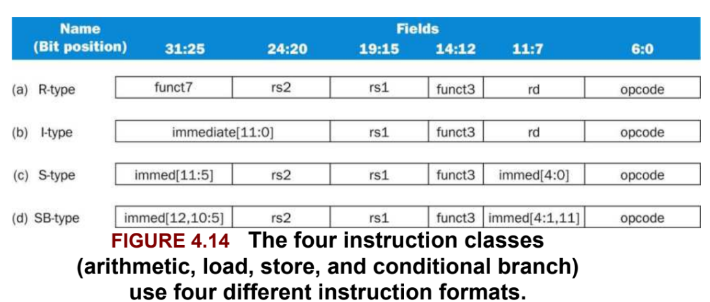
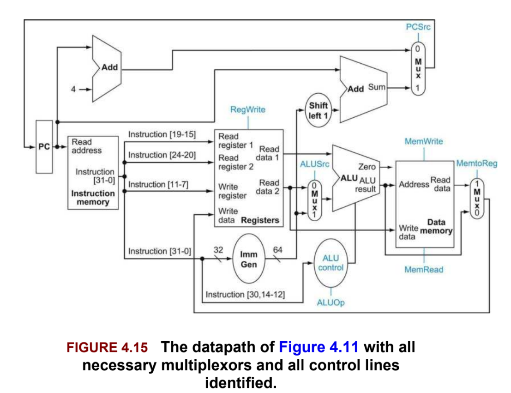
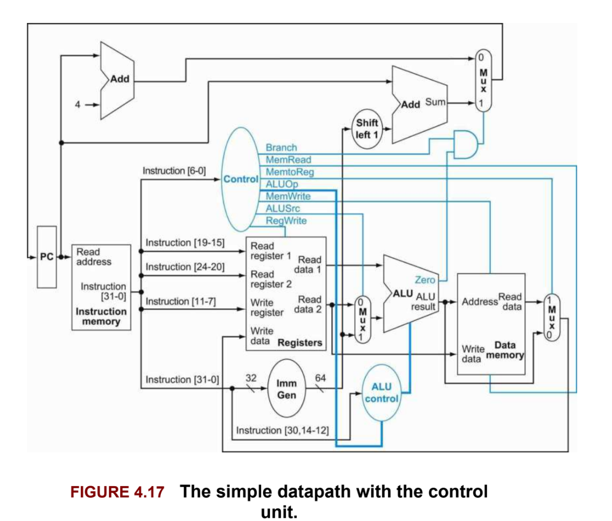
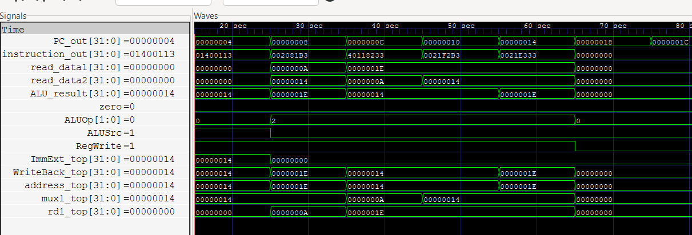
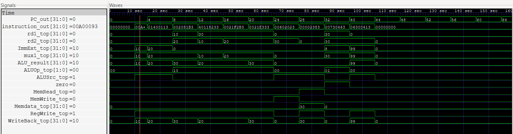

# 32-bit RISC-V Single-Cycle Processor

A 32-bit single-cycle RISC-V processor implemented in **Verilog HDL**.

The processor implements a subset of the RISC-V ISA using a single-cycle datapath consisting of the program counter, instruction memory, register file, immediate generator, control unit, ALU, data memory, multiplexers, and branch logic.

The design was developed with reference to the single-cycle RISC-V processor architecture described in *Computer Organization and Design: The Hardware/Software Interface, RISC-V Edition*, Chapter 4.

---

## Overview

This project implements a functional 32-bit RISC-V single-cycle processor capable of executing arithmetic, logical, memory access, and conditional branch instructions.

Each instruction is fetched, decoded, executed, and completed within a single clock cycle.

The processor includes:

- 32-bit program counter
- Instruction memory
- 32 × 32-bit register file
- Immediate generator
- Main control unit
- ALU control unit
- 32-bit ALU
- Data memory
- Write-back multiplexers
- Branch decision logic
- Program-counter update logic

The design is written entirely in **Verilog HDL** and verified using simulation with **Icarus Verilog** and **GTKWave**.

---

## Features

- 32-bit RISC-V datapath
- Single-cycle processor architecture
- RISC-V instruction decoding
- Register-register arithmetic and logical operations
- Immediate arithmetic
- Load/store operations
- Conditional branch
- ALU control logic
- Register file with 32 registers
- Separate instruction and data memories
- Self-checking Verilog testbench
- Waveform-based verification using GTKWave

---

## Supported Instructions

The processor currently supports the following instructions:

| Instruction | Type | Description |
|-------------|------|-------------|
| `ADD` | R-type | Add two registers |
| `SUB` | R-type | Subtract two registers |
| `AND` | R-type | Bitwise AND |
| `OR` | R-type | Bitwise OR |
| `ADDI` | I-type | Add immediate |
| `LW` | I-type | Load word from memory |
| `SW` | S-type | Store word to memory |
| `BEQ` | B-type | Branch if equal |

---

### Instruction Formats

The processor uses the RISC-V R-type, I-type, S-type, and B-type instruction formats.




### Single-Cycle Datapath

The complete datapath consists of the program counter, instruction memory, register file, immediate generator, ALU, data memory, multiplexers, branch logic, and control signals.



*Figure 4.15 — Single-cycle datapath with multiplexers and control lines.*

### Control Unit

The main control unit generates the control signals required to configure the datapath according to the opcode of the current instruction.



*Figure 4.17 — Single-cycle datapath with the control unit.*

---

## Control Signals

The main control unit generates the following control signals:

| Instruction | ALUSrc | MemtoReg | RegWrite | MemRead | MemWrite | Branch | ALUOp |
|-------------|--------|----------|----------|---------|----------|--------|-------|
| R-type      | 0      | 0        | 1        | 0       | 0        | 0      | 10    |
| `LW`        | 1      | 1        | 1        | 1       | 0        | 0      | 00    |
| `SW`        | 1      | X        | 0        | 0       | 1        | 0      | 00    |
| `BEQ`       | 0      | X        | 0        | 0       | 0        | 1      | 01    |
| `ADDI`      | 1      | 0        | 1        | 0       | 0        | 0      | 00    |

Where:

- `ALUSrc` selects the second ALU operand between a register value and immediate value.
- `MemtoReg` selects between ALU output and memory data for register write-back.
- `RegWrite` enables writing the ALU or memory result into the register file.
- `MemRead` enables data memory read operations.
- `MemWrite` enables data memory write operations.
- `Branch` enables conditional branch logic.
- `ALUOp` determines the operation required from the ALU control unit.
- `X` represents a don't-care condition.

---

## RTL Modules

All processor modules are implemented in a single Verilog source file, `risc.v`.

### `Program_Counter`

Stores the address of the current instruction.

### `PCpuls4`

Generates the sequential next PC by adding 4 to the current PC.

### `Instruction_Memory`

Stores the program instructions and provides the instruction corresponding to the current PC address.

### `Reg_File`

Implements the 32-register RISC-V register file.

- Two asynchronous read ports
- One synchronous write port
- Register `x0` is hardwired to zero

### `ImmGen`

Generates sign-extended immediate values for:

- I-type instructions
- S-type instructions
- B-type instructions

### `Control_Unit`

Decodes the instruction opcode and generates the main datapath control signals.

### `ALU_unit`

Performs arithmetic and logical operations:

- ADD
- SUB
- AND
- OR

### `ALU_Control`

Generates the 4-bit ALU control signal using `ALUOp`, `funct3`, and `funct7`.

### `Data_Memory`

Implements the processor's data memory for load and store operations.

### Multiplexers

The datapath uses multiplexers to select:

- ALU second operand
- Register write-back data
- Next PC

### `AND_Gate`

Combines the branch control signal with the ALU zero output to determine whether a branch should be taken.

### `Adder`

Used for calculating branch target addresses.

### `Top_Level`

Connects all processor components and forms the complete single-cycle CPU datapath.

---

## Instruction Execution

### R-type Instructions

For instructions such as:

```text
ADD x3, x1, x2
SUB x4, x3, x1
AND x5, x3, x2
OR  x6, x3, x2
```

The processor:

1. Fetches the instruction from instruction memory.
2. Reads the source registers from the register file.
3. Decodes the instruction using the control and ALU control units.
4. Performs the operation in the ALU.
5. Writes the ALU result into the destination register.
6. Updates the PC to `PC + 4`.

---

### Immediate Instructions

For an instruction such as:

```text
ADDI x1, x0, 10
```

the immediate generator extracts and sign-extends the immediate field.

The `ALUSrc` signal selects the immediate as the second ALU operand, and the ALU performs the addition.

---

### Load Word

For:

```text
LW x7, 0(x0)
```

the processor:

1. Reads the base register.
2. Generates the immediate offset.
3. Adds the base address and offset using the ALU.
4. Uses the resulting address to access data memory.
5. Writes the memory data back into the destination register.

---

### Store Word

For:

```text
SW x6, 0(x0)
```

the processor:

1. Reads the base register and source register.
2. Generates the store immediate.
3. Calculates the memory address using the ALU.
4. Writes the source register value into data memory.

---

### Branch if Equal

For:

```text
BEQ x6, x7, +8
```

the processor:

1. Reads both source registers.
2. The ALU subtracts the two register values.
3. If the result is zero, the `zero` signal is asserted.
4. The branch control signal is combined with `zero`.
5. If the branch condition is satisfied, the PC is updated to the branch target address.
6. Otherwise, execution continues with `PC + 4`.

---

## Verification

The processor was verified using a self-checking Verilog testbench.

The comprehensive testbench verifies:

- `ADDI`
- `ADD`
- `SUB`
- `AND`
- `OR`
- `SW`
- `LW`
- `BEQ`
- Branch target execution
- Skipped instruction during a taken branch

### Test Program

```text
ADDI x1, x0, 10
ADDI x2, x0, 20
ADD  x3, x1, x2
SUB  x4, x3, x1
AND  x5, x3, x2
OR   x6, x3, x2
SW   x6, 0(x0)
LW   x7, 0(x0)
BEQ  x6, x7, +8
ADDI x9, x0, 55
ADDI x8, x0, 99
```

### Simulation Result

The self-checking testbench produces:

```text
PASS: ADDI  x1 = 10
PASS: ADDI  x2 = 20
PASS: ADD   x3 = 30
PASS: SUB   x4 = 20
PASS: AND   x5 = 20
PASS: OR    x6 = 30
PASS: SW    Memory[0] = 30
PASS: LW    x7 = 30
PASS: BEQ   branch taken
PASS: BEQ   branch target reached
```

The branch test verifies that the instruction on the skipped path is not executed and that control is transferred to the correct branch target.

---

## Waveform Verification

### Basic Instruction Waveform

This waveform demonstrates the execution of arithmetic and logical instructions.



### Complete Processor Waveform

This waveform shows the interaction between the processor's datapath and control signals during execution.



The waveform demonstrates:

- Program counter progression
- Instruction fetch
- Register operand values
- Immediate generation
- ALU operation
- Memory read/write operations
- Register write-back
- Branch decision
- PC update after a taken branch

For the `BEQ` instruction, the PC changes from `32` to `40`, demonstrating that the branch was successfully taken.

---

## Simulation

### Requirements

- Icarus Verilog
- GTKWave
- VS Code
- Windows / MSYS2 UCRT64 environment

### Compile

From the project directory:

```bash
iverilog -o riscv_sim risc.v tb_top.v
```

### Run Simulation

```bash
vvp riscv_sim
```

### Open Waveform

```bash
gtkwave riscv.vcd
```

---

## Design Limitations

Current limitations include:

- Single-cycle implementation
- Limited instruction subset
- No pipelining
- No hazard detection or forwarding
- No interrupts or exceptions
- Limited instruction and data memory
- No cache hierarchy
- No CSR support
- No floating-point unit

---

## Future Work

Pipelined RISC-V processor, Hazard detection, Data forwarding, Pipeline registers, Larger instruction and data memories, Performance analysis, FPGA implementation

---

## References

1. David A. Patterson and John L. Hennessy,  
   *Computer Organization and Design: The Hardware/Software Interface, RISC-V Edition*, Chapter 4 — The Processor.

2. RISC-V Instruction Set Architecture specifications.

3. Verilog HDL documentation and simulation references.

---

## Tools Used

| Tool | Purpose |
|------|---------|
| Verilog HDL | Processor RTL implementation |
| VS Code | RTL development |
| Icarus Verilog | Compilation and simulation |
| GTKWave | Waveform analysis |
| MSYS2 UCRT64 | Windows development environment |
| Git / GitHub | Version control and project hosting |